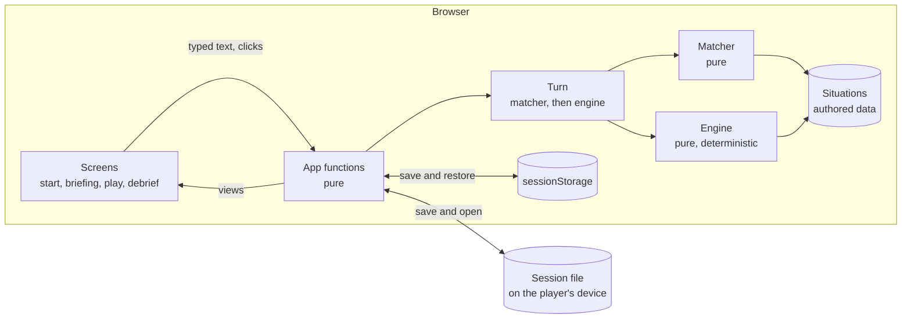
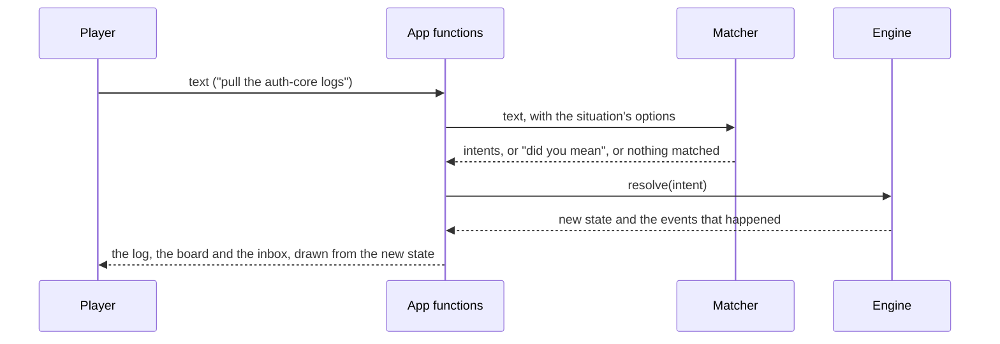
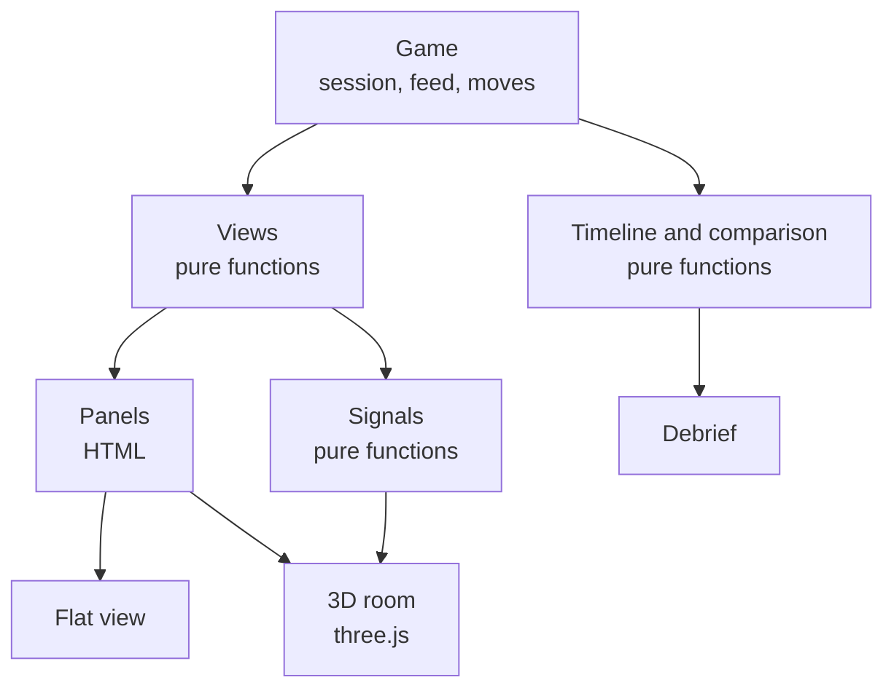

# High-level design

BrownOut is a static site. Everything runs in the browser: there is no server and no model, and the page fetches nothing but its own files (DL-24, DL-26). This document was rewritten at M4 to describe what is built. The earlier design, with a Node server and a language model, is in the decision log as DL-02 to DL-14.

## Parts



| Part | Where | Job |
|---|---|---|
| Engine | `src/engine` | Holds state, resolves intents, fires beats, scores, assembles the debrief |
| Situations | `src/scenarios` | Ground truth and every authored word |
| Matcher | `src/matcher` | Reads typed text against the situation's own options |
| Turn | `src/game` | One turn: the matcher reads, the engine resolves |
| App functions | `src/client/app` | The game as the interface sees it: the log feed, the board, threads, the record of moves, session files, the timeline |
| Screens and panels | `src/client/screens`, `src/client/panels` | Draw what the app functions return and hold what is local to a screen |
| Room | `src/client/room`, `src/client/signals` | The 3D view of the same state |

The engine imports nothing from the matcher, the client or the browser. It runs the same in a test, a terminal and a page.

## A turn



1. **The matcher cannot decide outcomes.** It returns identifiers that already exist in the situation, with the claims and promises it found in the text. The engine decides what those mean.
2. **A question costs nothing.** When two readings are close the matcher asks which was meant, and no time passes until the player answers (DL-25).
3. **Everything is synchronous.** A turn is a function call. There is nothing to wait for, so there is no loading state between typing and the result.

## Who decides what

| Question | Decided by |
|---|---|
| What time is it? How many customers are affected? | Engine |
| Did that mitigation work? | Engine, from the situation |
| What does this log search reveal? | Engine, from the situation |
| Does the CTO message now? | Engine, from beats and conditions |
| Was that statement to the press true? | Engine, from ground truth and what the player knew |
| What did the player mean by this sentence? | Matcher, or the player when it asks |
| How does the CTO phrase it? | The situation's author, with variants chosen by trust and the seed |
| What is the score, and what does the debrief say? | Engine, from the event log and authored lessons |

## Sessions, saves and recordings

A session is a pure function of two things: the seed and the list of moves the player made (DL-44). The app records each move as it happens: typed text, a reply in a thread, a choice from a question, a wait, idle minutes, the end.

| What | Where it lives | What is in it |
|---|---|---|
| The game in progress | The tab's `sessionStorage` | The whole game state, so a reload costs nothing (DL-33) |
| A saved session | A JSON file the player downloads from the debrief | The seed, the moves, a fingerprint of the result, and the event log in words for a person to read (DL-45) |
| A bundled sample | The site's own code | A seed and moves only |

Opening a saved session never draws anything from the file. The file is checked whole, then its moves are played through the same functions that typed text goes through, and the page shows what that produces. The fingerprint tells the player whether the result is the one the file recorded (DL-46).

Watching a recording uses the play screen with nothing in it that can change the session: the decision box is replaced by step and play controls, and the room or the flat view shows each step (DL-47).

## Source layout

```
src/
  engine/        state, clock, rules, scoring, debrief. No I/O.
  scenarios/     one folder per situation: data, authored text, accuracy set, playthroughs
  matcher/       reads typed text against the situation's options. No I/O.
  game/          one turn: the matcher reads, the engine resolves
  cli/           the terminal runner
  client/
    app/         pure functions: game and moves, session files, the debrief's timeline,
                 samples, sound
    panels/      board, log, inbox with its press group, decision box, replay controls
    screens/     start, briefing, play (the room or the flat view; also used to watch a
                 recording) and debrief
    room/        the 3D view. Room.tsx is the scene and is the only file that imports
                 three.js; it is loaded separately. Stations, the light fade, the frame
                 counter and the drawn textures are plain modules beside it.
    signals/     pure functions from the session to what the room shows
tools/           scripts called by hooks and CI, scenario validator, evidence
tests/           unit tests, scripted playthroughs, a whole typed session
e2e/             Playwright, against the built site
testresults/dod/ evidence per milestone
.githooks/       pre-commit, pre-push
```

## Client structure



- The panels are the interface. They are built once and used by both views.
- Flat view arranges the panels on a page. The 3D view places one beside the object the camera is looking at.
- `signals/` turns the session into a small description of the room: light level, which lamps are on, what the wall board shows, whether the television is on. It has no three.js in it and is unit tested.
- The room renders that description. It keeps no game state, so switching views or losing the graphics context loses nothing.
- The room is a separate chunk loaded during the briefing. Flat view never loads it.

Details are in [ui-design.md](ui-design.md).

## Deployment

A folder of static files, built by `npm run build`. Any static host will do, served from any path, because every address in the page is relative. There is no secret, no environment and nothing to keep running (O-02).

## Failure behaviour

| Failure | Behaviour |
|---|---|
| Typed text matches nothing | It costs one minute, is logged as not understood, and the nearest things that could be done are offered. |
| The browser cannot draw the 3D room, or stops being able to | The game carries on in flat view and says why. |
| The room draws slowly | Flat view is offered. Nothing is switched without the player. |
| Storage is blocked or the save is damaged | The game works without saving. A damaged save is dropped and the start screen opens. |
| A session file is too large, not a session, from a newer version, or for an unknown situation | It is refused with one plain sentence. Nothing is opened. |
| A session file's moves no longer give the result it recorded | It plays from its moves, and the page says the result differs. |
| The page is closed mid-session | The session is gone unless it was saved to a file. A reload in the same tab restores it. |
