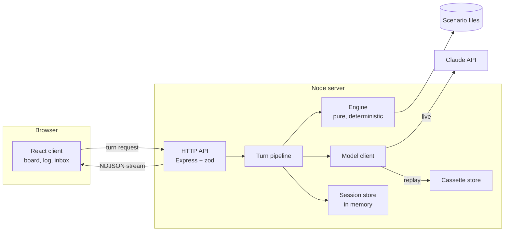
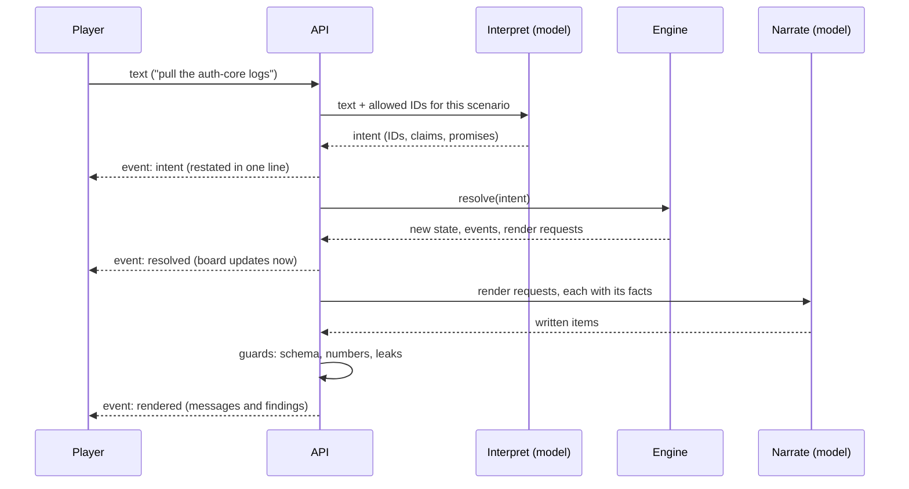

# High-level design

## Parts



| Part | Job | Knows about the model? |
|---|---|---|
| Engine | Holds state, resolves intents, fires beats, scores | No |
| Scenario files | Ground truth and all authored content | No |
| Turn pipeline | Runs interpret, resolve, narrate in order and applies the guards | Yes |
| Model client | One place that talks to the Claude API or to a cassette | Yes |
| Session store | Maps a session ID to its state and event log | No |
| HTTP API | Validates input, enforces limits, streams turn events | No |
| Client | Shows state, sends input, runs the idle clock | No |

The engine imports nothing from the server, the model client or the browser. It can be run from a test or a terminal with no network.

## A turn



Three things to note:

1. **Interpret cannot decide outcomes.** It returns identifiers that already exist in the scenario, plus the claims and promises it found in the text. The engine decides what those mean.
2. **Narrate works from settled facts.** By the time it is called, the turn's outcome is fixed. Each piece of text it writes comes with the exact facts and numbers it may use.
3. **Wait and idle ticks skip interpret.** If the engine produces no render requests, narrate is skipped too, and the turn costs nothing.

## Who decides what

| Question | Decided by |
|---|---|
| What time is it? How many customers are affected? | Engine |
| Did that mitigation work? | Engine, from the scenario |
| What does this log search reveal? | Engine, from the scenario |
| Does the CTO message now? | Engine, from beats and conditions |
| Was that statement to the press true? | Engine, from ground truth and the player's known facts |
| What did the player mean by this sentence? | Model (interpret) |
| How does the CTO phrase it, given low trust and a missed ETA? | Model (narrate) |
| What does the news story say, given these facts? | Model (narrate) |
| What is the score? | Engine |
| How should the debrief explain the score? | Model (debrief), citing events |

## Run modes

| Mode | Model calls | Use |
|---|---|---|
| live | Real calls to the Claude API | Local play with a key in `.env` |
| record | Real calls, responses saved to a cassette | Making fixtures and the demo session |
| replay | None. Responses come from a cassette or an exported session | Public demo, browser tests, CI |

With no API key the server starts in replay mode.

## Source layout

```
src/
  engine/        state, clock, rules, scoring. No I/O.
  scenarios/     one folder per scenario: data, fallback copy, accuracy set
  pipeline/      turn pipeline, guards, prompt builders
  model/         Claude client wrapper, cassette player and recorder, usage log
  server/        Express app, routes, session store, rate limits
  client/        React app
  shared/        zod schemas and types used by server and client
tools/           scripts called by hooks and CI, scenario validator, terminal runner
tests/           unit, integration, scripted playthroughs
e2e/             Playwright
cassettes/       recorded sessions
testresults/dod/ evidence per milestone
.githooks/       pre-commit, pre-push
```

## Deployment

One Node process serves the API and the built client. There is no database and no other service. The public demo is this process in replay mode with no secret configured (DL-11, O-02).

## Failure behaviour

| Failure | Behaviour |
|---|---|
| Interpret fails or is declined | Treat the input as an unmatched action: it costs one minute and is logged as "not understood, try rephrasing". No state change beyond time. |
| Narrate fails, is declined or fails a guard twice | Use the authored fallback text for each render request. |
| Daily budget reached | New live turns are refused with a clear message. The session can be exported. Replay works. |
| Server restarts | Sessions are lost. The client says so and offers to start again. |
| Client loses connection mid-turn | The turn finishes on the server. The client fetches the session state on reconnect. |
